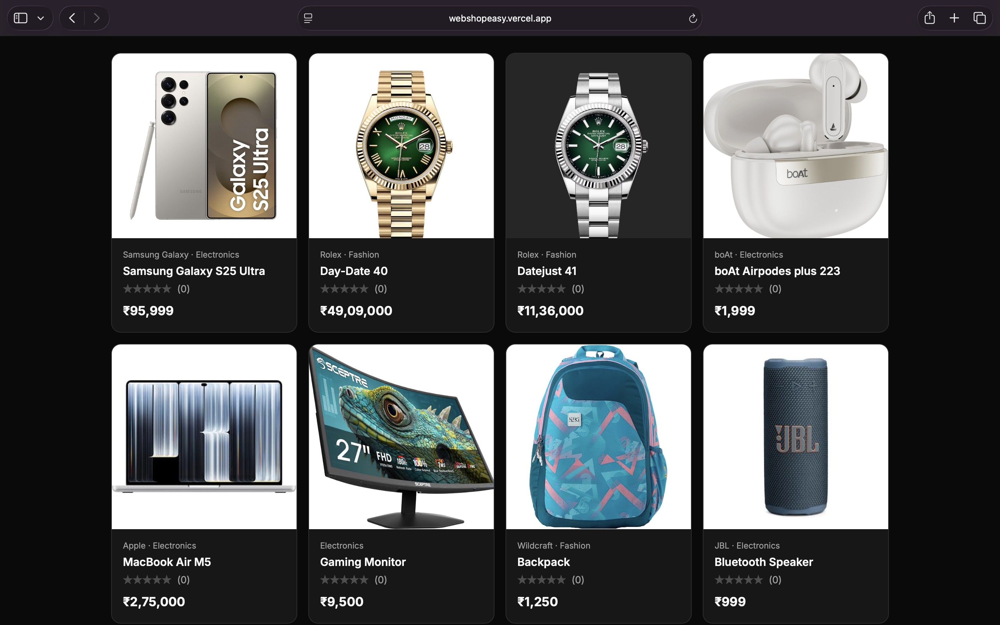
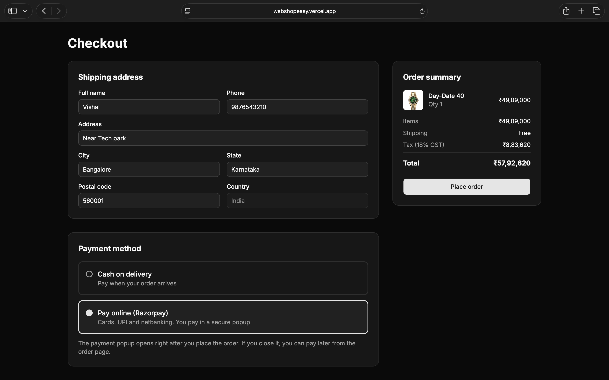
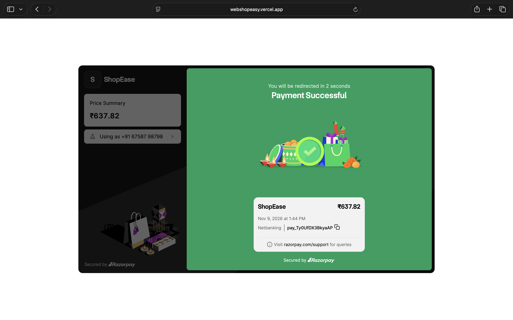
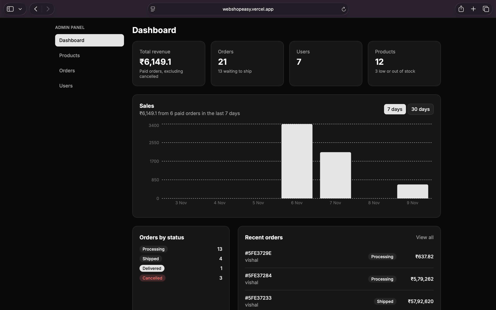
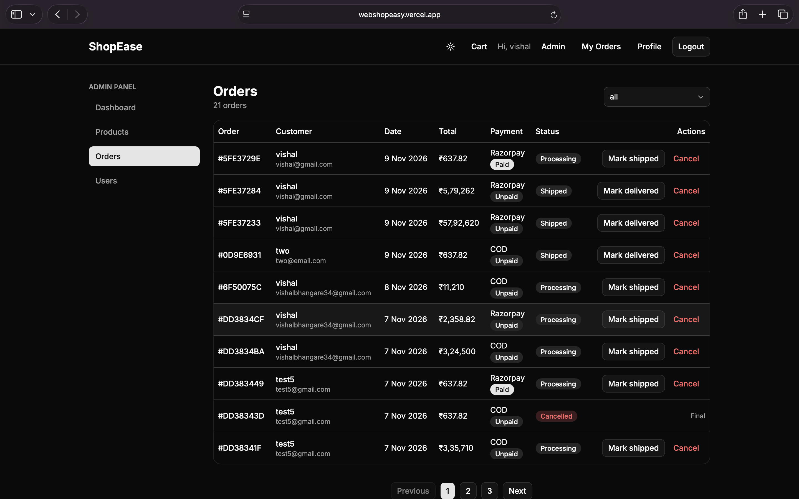

# ShopEase: Full-Stack MERN E-commerce

A production-style e-commerce application with JWT authentication, Razorpay payments, an admin dashboard, and automated API tests. Deployed on Vercel, Render and MongoDB Atlas.

[](https://webshopeasy.vercel.app)
[](https://shoease-api.onrender.com/api/health)

> **Note:** the API runs on Render's free tier, which sleeps when idle. The first request after a quiet period can take up to a minute while it wakes up. Payments run in Razorpay **test mode**, so no real money is involved.


## Table of contents

- [Features](#features)
- [Screenshots](#screenshots)
- [Tech stack](#tech-stack)
- [Architecture](#architecture)
- [Engineering highlights](#engineering-highlights)
- [API overview](#api-overview)
- [Project structure](#project-structure)
- [Run locally](#run-locally)
- [Environment variables](#environment-variables)
- [Testing](#testing)
- [Deployment](#deployment)
- [Roadmap](#roadmap)
- [Author](#author)

## Features

**Customers**
- Register, login and persistent sessions (JWT)
- Product search, category filter, price range, sorting and pagination, all synced to the URL so links are shareable
- Product details with image gallery, stock status, ratings and reviews (one review per user, editable)
- Server-side cart that persists across devices, with stock-aware quantity limits
- Checkout with address validation, paying by **Razorpay** (cards, UPI, netbanking) or **Cash on Delivery**
- Order history with filters, order tracking, and cancellation of unpaid orders
- Light and dark theme

**Admin**
- Dashboard with revenue, order, user and low-stock numbers plus a 7 and 30 day sales chart (MongoDB aggregation)
- Product management: create, edit and delete with multi-image upload (Cloudinary)
- Order management with a status workflow (Processing, Shipped, Delivered, Cancelled)
- User management with role changes and safeguards (an admin can't demote or delete themselves)

## Screenshots

| Storefront | Product page |
|---|---|
|  |  |

| Cart and checkout | Razorpay payment |
|---|---|
|  |  |

| Admin dashboard | Admin orders |
|---|---|
|  |  |

## Tech stack

| Layer | Technologies |
|---|---|
| Frontend | React, Vite, Tailwind CSS, shadcn/ui, Redux Toolkit, React Router, Axios, Recharts |
| Backend | Node.js, Express, Mongoose, JWT, bcrypt |
| Database | MongoDB Atlas |
| Services | Cloudinary (images), Razorpay (payments), Brevo / Nodemailer (email) |
| Security | Helmet, express-rate-limit, express-validator, CORS allow-list |
| Testing | Vitest, Supertest, mongodb-memory-server |
| Hosting | Vercel (frontend), Render (API), MongoDB Atlas |

## Architecture

```
┌──────────────────┐   HTTPS / JSON    ┌───────────────────┐
│  React SPA       │ ────────────────▶ │  Express REST API │
│  (Vercel)        │ ◀──────────────── │  (Render)         │
└────────┬─────────┘                   └─────────┬─────────┘
         │ Razorpay Checkout                     │
         ▼                                       ├──▶ MongoDB Atlas
   ┌────────────┐                                ├──▶ Cloudinary (images)
   │  Razorpay  │ ◀── verify signature ──────────├──▶ Razorpay API (orders)
   └────────────┘                                └──▶ Brevo (email)
```

## Engineering highlights

- **Payment integrity:** the amount is always read from the database, never the browser. Payments are confirmed by recomputing the Razorpay HMAC signature on the server with a timing-safe comparison. The verify endpoint is idempotent, and the Razorpay order ID is matched to the order it was created for.
- **No overselling:** stock is reserved with an atomic `findOneAndUpdate({ stock: { $gte: qty } })` and rolled back if the order fails midway.
- **Price snapshots:** orders store the name and price at purchase time, so later catalog changes don't rewrite history.
- **Server-calculated totals:** shipping, GST and totals are computed on the server, so the UI can't show a price the server wouldn't charge.
- **Layered security:** Helmet headers, rate limiting (strict on login and register), CORS allow-list, a NoSQL-injection guard, input validation, regex escaping in search filters, request size limits, and production-safe error messages.
- **Role-based access control:** `protect` and `admin` middleware, with server-side ownership checks on orders and payments.
- **Resilient email:** order emails never block or break an order. Providers are pluggable (HTTP API for hosts that block SMTP, Nodemailer for local use).
- **Frontend quality:** request cancellation to prevent stale responses, skeleton loaders, protected and admin-only routes, and URL-driven filters.
- **Tested API:** automated tests run against an in-memory MongoDB, so real data is never touched.

## API overview

All routes are prefixed with `/api`. 🔒 = login required, 👑 = admin only.

| Area | Endpoints |
|---|---|
| Health | `GET /health` |
| Auth | `POST /auth/register` · `POST /auth/login` · 🔒 `GET /auth/me` |
| Products | `GET /products` (search, filter, sort, paginate) · `GET /products/categories` · `GET /products/:id` · 👑 `POST /products` · 👑 `PUT /products/:id` · 👑 `DELETE /products/:id` · 👑 `DELETE /products/:id/images` · 🔒 `POST /products/:id/reviews` |
| Cart | 🔒 `GET /cart` · 🔒 `POST /cart` · 🔒 `PUT /cart/:productId` · 🔒 `DELETE /cart/:productId` · 🔒 `DELETE /cart` |
| Orders | 🔒 `POST /orders` · 🔒 `GET /orders/myorders` · 🔒 `GET /orders/:id` · 🔒 `PUT /orders/:id/cancel` · 👑 `GET /orders` · 👑 `PUT /orders/:id/status` |
| Payment | 🔒 `POST /payment/create-order` · 🔒 `POST /payment/verify` |
| Users | 👑 `GET /users` · 👑 `PUT /users/:id/role` · 👑 `DELETE /users/:id` |
| Admin | 👑 `GET /admin/stats` |

## Project structure

```
shopease/
├── client/                  # React frontend
│   └── src/
│       ├── api/             # Axios instance and API modules
│       ├── components/      # Navbar, ProductCard, ProtectedRoute, ui/ (shadcn)
│       ├── lib/             # formatters, Razorpay loader
│       ├── pages/           # storefront, cart, checkout, orders, admin/
│       └── redux/           # auth and cart slices
└── server/                  # Express backend
    ├── config/              # db, cloudinary, razorpay, env validation
    ├── controllers/
    ├── middleware/          # auth, validation, rate limits, sanitizing, errors
    ├── models/              # User, Product, Cart, Order
    ├── routes/
    ├── tests/               # Vitest + Supertest
    ├── utils/               # email, price calculation, helpers
    ├── app.js               # Express app (importable by tests)
    └── server.js            # startup and graceful shutdown
```

## Run locally

**Prerequisites:** Node.js 20+, a MongoDB Atlas database (or local MongoDB), and free Cloudinary and Razorpay (test mode) accounts.

```bash
git clone https://github.com/bvishal-27/shoease.git
cd shoease

# Backend
cd server
npm install
cp .env.example .env      # fill in your values
npm run dev               # http://localhost:5000

# Frontend (new terminal)
cd client
npm install
cp .env.example .env
npm run dev               # http://localhost:5173
```

To create an admin user, register normally, then promote the account:

```bash
cd server
ADMIN_EMAIL="you@example.com" ADMIN_PASSWORD="a-strong-password" node utils/createAdmin.js
```

## Environment variables

**`server/.env`**

| Variable | Purpose |
|---|---|
| `NODE_ENV` | `development` or `production` |
| `PORT` | API port (default 5000) |
| `MONGO_URI` | MongoDB connection string, including the database name |
| `JWT_SECRET` | Signing secret (32+ characters in production) |
| `JWT_EXPIRES_IN` | Token lifetime, e.g. `7d` |
| `CLIENT_URL` | Frontend origin for CORS, with no trailing slash |
| `CLOUDINARY_CLOUD_NAME`, `CLOUDINARY_API_KEY`, `CLOUDINARY_API_SECRET` | Image storage |
| `RAZORPAY_KEY_ID`, `RAZORPAY_KEY_SECRET` | Payments (test keys) |
| `BREVO_API_KEY`, `BREVO_SENDER_EMAIL` | Optional: email through an HTTP API (works on hosts that block SMTP) |
| `EMAIL_USER`, `EMAIL_PASS` | Optional: SMTP email for local development |

**`client/.env`**

| Variable | Purpose |
|---|---|
| `VITE_API_URL` | API base URL, e.g. `http://localhost:5000/api` |

If no email provider is configured, emails are skipped and orders work normally.

## Testing

```bash
cd server
npm test
```

About 20 tests cover registration and login, role-based access, NoSQL-injection blocking, validation, product search, filtering and pagination, and the review flow. They run against an in-memory MongoDB.

## Deployment

| Part | Service | Notes |
|---|---|---|
| Frontend | Vercel | Root `client`, with `vercel.json` rewriting all routes to `index.html` for SPA routing |
| API | Render | Root `server`, start command `npm start`, health check `/api/health` |
| Database | MongoDB Atlas | Separate `shopease_prod` database for production |

Render's free tier blocks outbound SMTP, so production email goes through an HTTP API instead.

## Roadmap

- Razorpay webhook so orders are marked paid even if the browser closes mid-payment
- Refund handling for cancelled paid orders
- Password reset by email and email verification
- Wishlist and coupon codes
- Product variants (size and colour)
- End-to-end tests with Playwright

## Author

**Vishal Bhangare**
[GitHub](https://github.com/bvishal-27) · [LinkedIn](www.linkedin.com/in/b-vishal27)