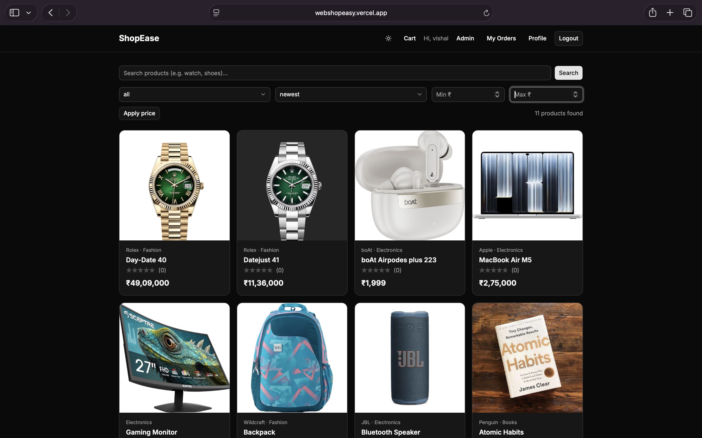

# ShopEase: MERN E-commerce

A full-stack e-commerce app with JWT auth, Razorpay payments, an admin dashboard and email notifications.

**Live demo:** https://your-site.vercel.app
**API health:** https://shopease-api.onrender.com/api/health

> The backend runs on Render's free tier, so the first request after idle can take up to a minute.



## Features

**Customers**
- Register, login, persistent sessions
- Product search, category and price filters, sorting, pagination (URL-synced)
- Product reviews and ratings
- Server-side cart, checkout with address validation
- Pay online with Razorpay (signature-verified) or Cash on Delivery
- Order history, cancel unpaid orders, email confirmations
- Light and dark mode

**Admin**
- Dashboard with revenue, order counts and a sales chart (MongoDB aggregation)
- Product management with multi-image upload (Cloudinary)
- Order management with status workflow
- User management with role changes

## Tech stack

React, Vite, Tailwind CSS, shadcn/ui, Redux Toolkit, React Router, Node.js, Express, MongoDB (Mongoose), Cloudinary, Razorpay, Brevo, Vitest, Supertest

## Engineering highlights

- **Payments:** amounts come from the database, never the browser; HMAC signature verified with a timing-safe comparison; verify endpoint is idempotent
- **Stock safety:** atomic `findOneAndUpdate` with `stock >= qty` prevents overselling; stock is rolled back if an order fails
- **Security:** Helmet, rate limiting on auth routes, CORS allow-list, NoSQL-injection guard, input validation, regex escaping, production-safe errors
- **Orders store price snapshots**, so later price changes don't alter history
- **Testing:** ~20 API tests against an in-memory MongoDB

## Architecture

```
React (Vercel)  -->  Express API (Render)  -->  MongoDB Atlas
                          |-- Cloudinary (images)
                          |-- Razorpay (payments)
                          |-- Brevo (email)
```

## Run locally

```bash
git clone https://github.com/bvishal-27/shopease.git
cd shopease/server && npm install
cp .env.example .env    # fill in your values
npm run dev

cd ../client && npm install
cp .env.example .env
npm run dev
```

Run the tests: `cd server && npm test`

## Environment variables

See `server/.env.example` and `client/.env.example`.

## Author
B Vishal.
